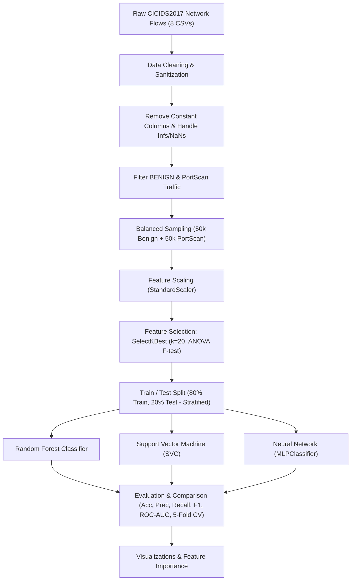

# 🛡️ CICIDS2017 Network Intrusion Detection System (NIDS)
### PortScan Attack Detection & Traffic Classification using Machine Learning

[](https://www.python.org/)
[](https://scikit-learn.org/)
[](https://www.unb.ca/cic/datasets/ids-2017.html)
[]()

---

## 📌 1. Project Overview (Ta'aruf / Introduction)

Yeh project **CICIDS2017 (Canadian Institute for Cybersecurity Intrusion Detection System 2017)** benchmark dataset par mabni ek **Network Intrusion Detection System (NIDS)** hai. 

Iska bunyadi maqsad real-world network flows ka tajzia karna aur normal (**BENIGN**) network traffic aur malicious **PortScan** (Port Reconnaissance Attacks) ke darmian accurate classification karna hai.

Network environment mein cyber attackers kisi system ya server par attack launch karne se pehle **Port Scanning** (maslan Nmap scanning, SYN scans wagerah) ke zariye open ports aur services dhoondte hain. Is machine learning system ka kaam aisi suspicious activity ko early stage par hi detect aur flag karna hai.

---

## 🎯 2. Project Goals & Objectives

- **Traffic Extraction & Consolidation:** Real network captures (8 PCAP-derived CSV files) se network flow data analyze karna.
- **Data Preprocessing & Sanitization:** Infinite values (`np.inf`), `NaN` missing values, aur constant columns ko filter karna.
- **Class Balancing:** Data imbalance ko khatam karne ke liye 50,000 Benign aur 50,000 PortScan samples (total 100,000 balanced instances) extract karna.
- **Feature Selection:** Statistical ANOVA F-score (`SelectKBest`) ke zariye 78+ flow attributes mein se Top 20 most discriminatory features select karna.
- **Multi-Model Benchmark:** 3 alag machine learning architectures ko train aur compare karna:
  1. **Random Forest Classifier** (Ensemble Tree Model)
  2. **Support Vector Machine (SVM)** (Hyperplane Classifier)
  3. **Feedforward Neural Network / MLP** (Multi-Layer Perceptron)
- **Model Evaluation:** Accuracy, Precision, Recall, F1-Score, Confusion Matrix, ROC-AUC Curve, aur 5-Fold Stratified Cross-Validation calculate karna.
- **Exploratory Data Analysis (EDA):** Top targeted ports, packet flow durations, aur packet sizes ki visual analysis.

---

## 🏗️ 3. Machine Learning Pipeline Architecture



---

## 📂 4. Project Directory Structure

```text
project2/
├── .gitignore                                         # Prevents committing large CSVs and cache
├── requirements.txt                                   # Required Python libraries
├── README.md                                          # Project documentation and guide (This file)
├── PROJECT_REPORT.md                                  # Detailed academic / technical project report
├── DATASET_GUIDE.md                                   # Comprehensive reference for 79 CICIDS2017 features
├── FIX_AND_OPTIMIZATION_GUIDE.md                      # Guide to resolve MemoryError and optimize code
├── pipeline_optimized.py                              # Fully working, memory-efficient ML execution script
├── Untitled.ipynb                                     # Original Jupyter notebook
└── [Dataset Files: ~1 GB Total]
    ├── Friday-WorkingHours-Afternoon-DDos.pcap_ISCX.csv
    ├── Friday-WorkingHours-Afternoon-PortScan.pcap_ISCX.csv
    ├── Friday-WorkingHours-Morning.pcap_ISCX.csv
    ├── Monday-WorkingHours.pcap_ISCX.csv
    ├── Thursday-WorkingHours-Afternoon-Infilteration.pcap_ISCX.csv
    ├── Thursday-WorkingHours-Morning-WebAttacks.pcap_ISCX.csv
    ├── Tuesday-WorkingHours.pcap_ISCX.csv
    └── Wednesday-workingHours.pcap_ISCX.csv
```

---

## ⚠️ 5. Analysis: Why the Original Notebook Crashed (`MemoryError`)

Agar aap `Untitled.ipynb` ko open karein, to Cell 4 (`In[81]`) par yeh error aaya tha:
```text
MemoryError: Unable to allocate 445. MiB for an array with shape (24, 2432027) and data type float64
```

### Wajah (Root Cause):
1. Notebook ne tamam 8 CSV files ko pehle memory mein load kiya (`df1` se `df8`).
2. Phir un sab ko `pd.concat` karke **2,830,743 rows** aur **79 columns** ka massive DataFrame banaya.
3. Tamam numeric columns default `float64` dtypes par the jo **8 GB+ RAM** consume kar rahe the.
4. Jab `filtered_df = merged_df[...].copy()` call hua, to Windows RAM aur paging memory khatam ho gayi, jiski wajah se **Cell 5 se Cell 17 tak koi bhi cell execute nahi ho saka**!

### Solution (Hal):
- Humne is maslay ko solve karne ke liye **`pipeline_optimized.py`** aur **`FIX_AND_OPTIMIZATION_GUIDE.md`** tayyar kar diya hai.
- Yeh optimized pipeline sirf targeted files se data stream/filter karta hai, dtypes ko optimize karta hai, memory leak nahi hone deta, aur 2-4 minutes mein bina crash hue smoothly run ho jata hai.

---

## 📥 6. Dataset Download & Setup (Data Kahan Se Milega?)

GitHub par large files (~1 GB) commit nahi ki ja sakteen, isliye CSV files `.gitignore` mein hain. Kisi bhi naye user ko yeh project chalane ke liye sirf yeh karna hoga:

1. **Dataset Download Source:**
   - **Official Portal:** [Canadian Institute for Cybersecurity (CIC) UNB](https://www.unb.ca/cic/datasets/ids-2017.html)
   - **Kaggle Mirror (Direct Fast Download):** [Kaggle CICIDS2017 Dataset](https://www.kaggle.com/datasets/cicdataset/cicids2017)
2. **Zaroori File (Required):**
   - Sirf yeh ek file download karein:  
     `Friday-WorkingHours-Afternoon-PortScan.pcap_ISCX.csv` (~77 MB)
3. **File Placement:**
   - Downloaded CSV file ko project ke root directory mein rakh dein (jahan `pipeline_optimized.py` mojud hai).

---

## 🚀 7. Installation & Quickstart

### Step 1: Clone / Open Directory
Apne terminal ya command prompt mein project folder mein jayein:
```bash
cd c:\Users\Asawir\Desktop\project2
```

### Step 2: Virtual Environment Setup (Recommended)
```bash
python -m venv venv
# Windows activate:
venv\Scripts\activate
```

### Step 3: Dependencies Install Karein
```bash
pip install -r requirements.txt
```

### Step 4: Optimized Pipeline Run Karein
Aap bina memory crash ke complete training, evaluation aur plots generate karne ke liye yeh command chalayein:
```bash
python pipeline_optimized.py
```
Yeh script automatically:
1. Data ko memory-efficiently process karega.
2. 50k Benign aur 50k PortScan samples balance karega.
3. Top 20 features extract karega.
4. Teeno models (Random Forest, SVM, MLP) train karega.
5. Metrics print karega aur plots ko `outputs/` folder mein save kar dega!

---

## 📊 7. Machine Learning Models & Metrics

| Model | Type | Hyperparameters / Structure | Best Use Case |
| :--- | :--- | :--- | :--- |
| **Random Forest** | Ensemble of Decision Trees | `n_estimators=100, random_state=42` | High accuracy, robust to outliers, non-linear relationships |
| **SVM (SVC)** | Support Vector Classifier | `probability=True, random_state=42` | High-dimensional separation, strong theoretical bounds |
| **FNN (MLP)** | Multi-Layer Perceptron | Hidden Layers: `(64, 32)`, `max_iter=300` | Deep feature representation, complex network patterns |

### Evaluation Metrics Used:
- **Accuracy:** Overall percentage of correct classifications.
- **Precision:** $\frac{TP}{TP + FP}$ — PortScan alerts mein se kitne alerts waqai attacks the (False Alarms ko kam karna).
- **Recall (Detection Rate):** $\frac{TP}{TP + FN}$ — Actual PortScan attacks mein se kitne attacks detect huay (Crucial for cybersecurity).
- **F1-Score:** Precision aur Recall ka Harmonic Mean.
- **ROC-AUC:** Classifier ki discriminatory capacity across different thresholds.
- **5-Fold Stratified Cross-Validation:** Overfitting ko check karne ke liye model generalization validation.

---

## 📈 8. Key Exploratory Data Analysis (EDA) Insights

1. **Top Targeted Destination Ports:**
   Port scanning aam taur par standard discovery ports (e.g. port 80 [HTTP], 443 [HTTPS], 21 [FTP], 22 [SSH], 445 [SMB]) aur random sequential port ranges par focused hoti hai.
2. **Flow Duration Differences:**
   PortScan flows aam taur par short-lived (very small `Flow Duration`) hote hain kyunki scanner jaldi se TCP SYN packet bhej kar response check karta hai aur connection terminate/drop kar deta hai.
3. **Packet Size Anomaly:**
   BENIGN traffic mein payloads (HTML, images, media) ki wajah se packet sizes broad range mein hoti hain, jabke PortScan traffic mein average packet size bohot chhota aur consistent hota hai (mostly TCP header packets without payload).

---

## 📚 9. Additional Documentation Links

- 📖 [Project Technical Report](file:///c:/Users/Asawir/Desktop/project2/PROJECT_REPORT.md) — Detailed scientific report with threat modeling and in-depth methodology.
- 📋 [Dataset Feature Guide](file:///c:/Users/Asawir/Desktop/project2/DATASET_GUIDE.md) — Comprehensive guide explaining all 79 network flow features.
- 🛠️ [Fix and Optimization Guide](file:///c:/Users/Asawir/Desktop/project2/FIX_AND_OPTIMIZATION_GUIDE.md) — Step-by-step instructions to fix Jupyter Notebook memory crashes.

---

## 📜 10. Citation & Dataset Acknowledgement

Dataset provided by:
> **Canadian Institute for Cybersecurity (CIC)**  
> University of New Brunswick (UNB)  
> *Iman Sharafaldin, Arash Habibi Lashkari, and Ali A. Ghorbani, "Toward Generating a New Dataset for Cybersecurity Analysis", ICISSP 2018.*
